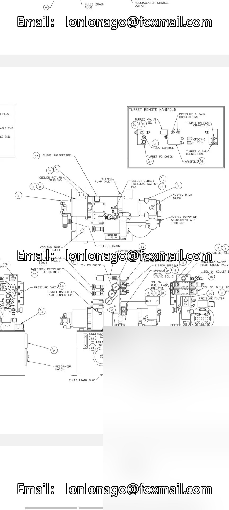
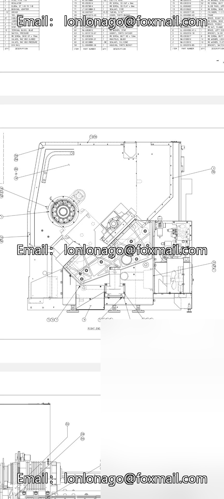
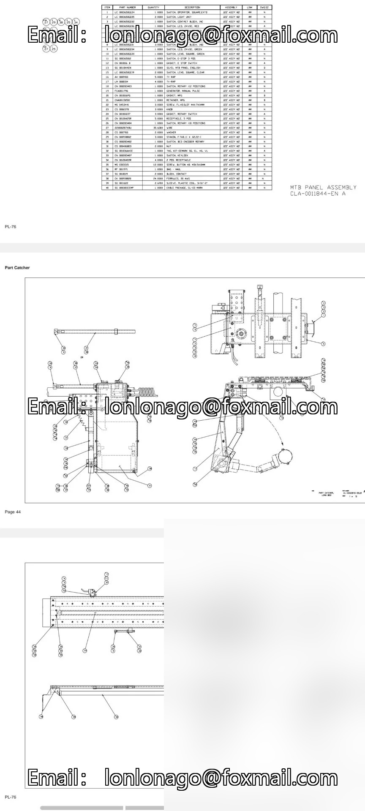
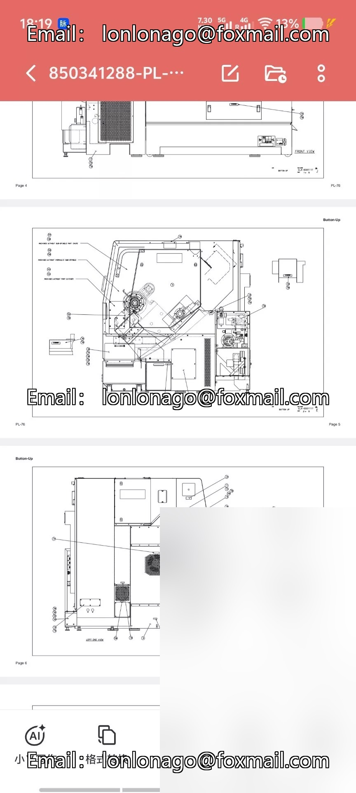
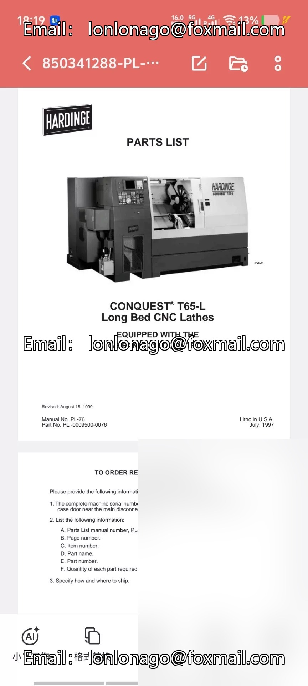

# Haddeng CONQUEST T65-L long bed CNC lathe (GE FAN)

## Body

Huntington CONQUEST T65-L long bed CNC lathe (GE FANUC 18T control), original drawing data, including PL-76, with a total of 100 pages, in PDF format, with complete and clear content.

Applicable to mechanical design Mechanical manufacturing Automation Dynamics Mechanical and electronic engineering Material forming Robot Mechanical and electrifying integrated fields and other professional areas Can be used for mechanical structure System principles Component layout Assembly relationships and other learning references.

are non-refundable upon sale. If you need to take them directly, please chat privately.
1288

The product is the Haddingge CONQUEST T65-L long bed CNC lathe with GE FANUC 18T control, offering PL-76 content; a complete 100-page PDF is provided, applicable to mechanical design, manufacturing and other professional fields.

<!-- AI_ENRICHED -->

## Images

## Payment

Here is a pay link on Stripe ( https://buy.stripe.com/3cs8yP7sY87d0vu9AB ). Please contact me lonlonago@foxmail.com after funding $89, and I will send you a complete data files , thank you!

